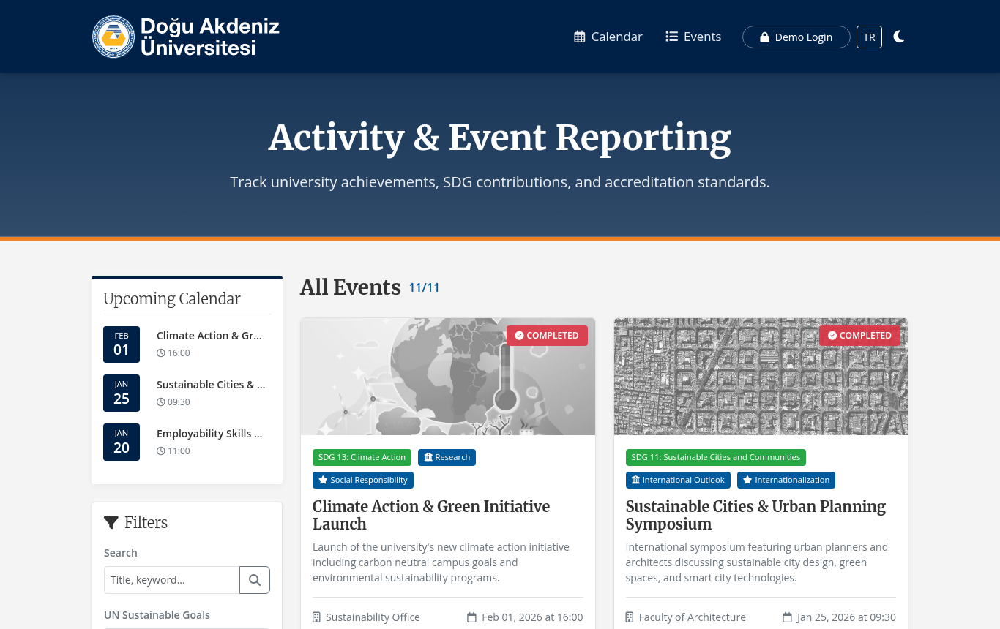
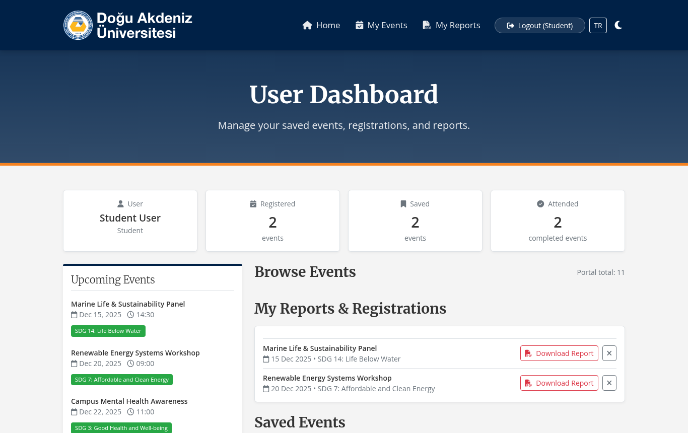
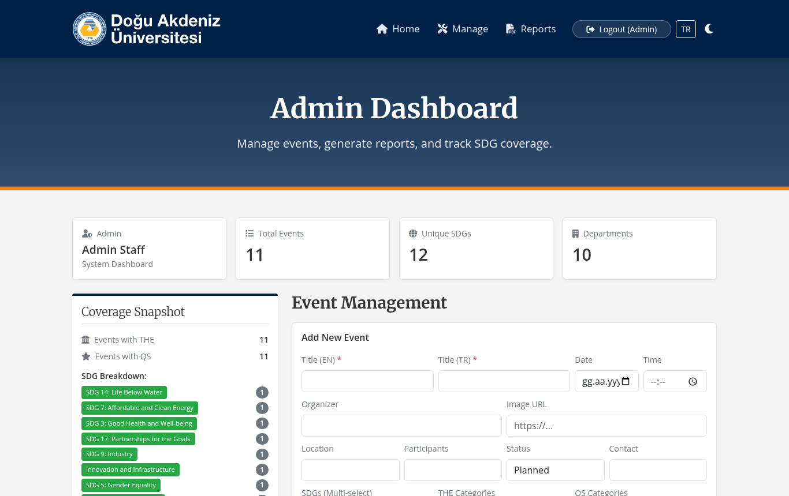
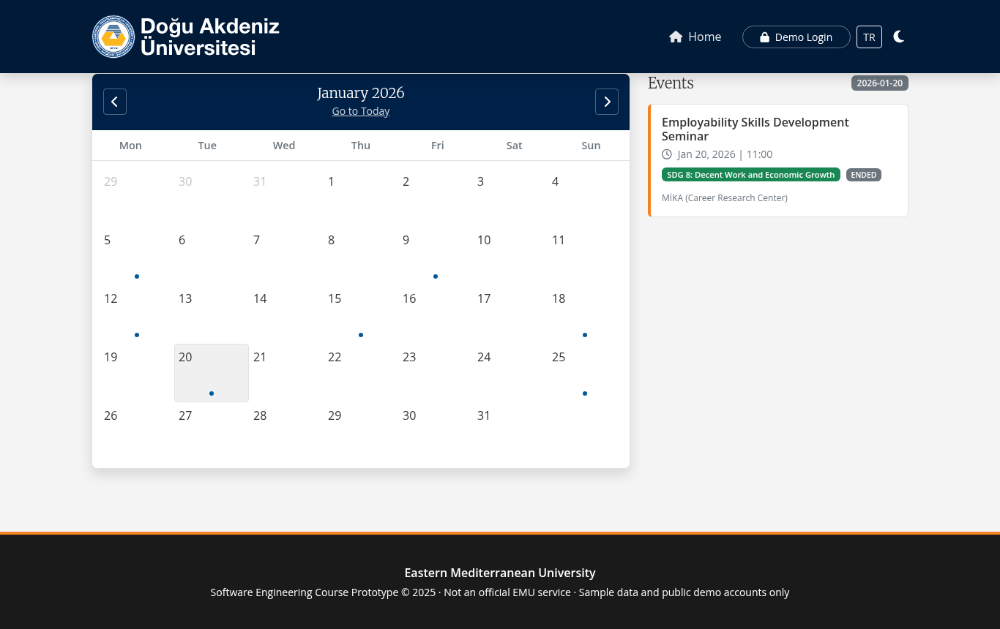
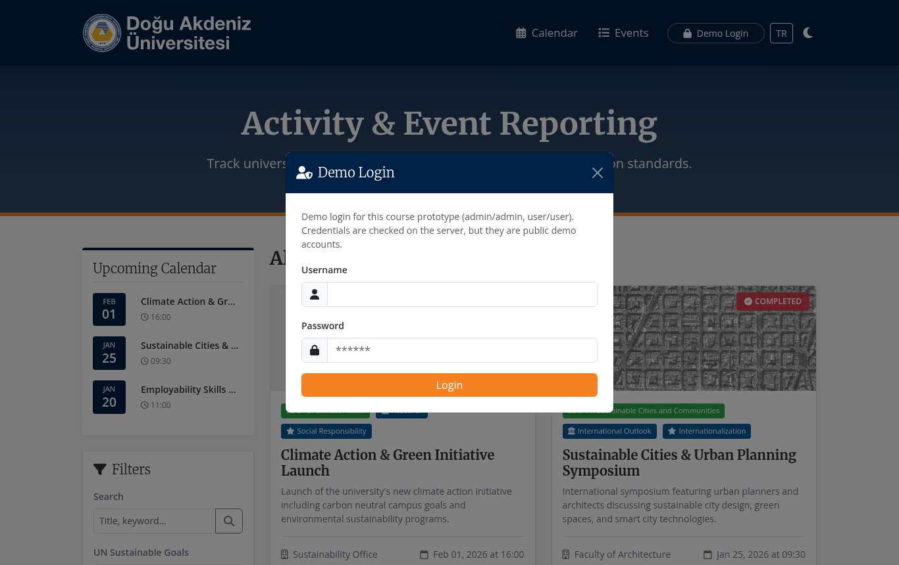

# 🌍 EMU Activity & Event Reporting Portal

> A bilingual (EN/TR) PHP web portal for recording university activities and events, tagging them with UN Sustainable Development Goals, THE Impact Rankings and QS Stars criteria, and exporting reports.



---

## 🏫 University Coursework

| | |
|---|---|
| **University** | Eastern Mediterranean University (EMU) |
| **Course** | ITEC316 |
| **Semester** | Fall 2025 |
| **Academic Year** | 2025–2026 |

This project was developed as a course assignment. It is shared for educational purposes and is not intended for production use. It is **not an official EMU service**.

The state of the code at the end of the course is preserved under the Git tag [`coursework-final`](../../tree/coursework-final). Everything after that tag is follow-up work, documented in [Post-Coursework Improvements](#-post-coursework-improvements).

---

## ⚠️ Prototype Notice

- **Demo accounts only.** Login uses two hard-coded demo accounts (`admin` / `admin`, `user` / `user`). They are checked on the server, but the passwords are public, so they protect nothing on a public server.
- **Local use only.** The admin panel refuses every request that does not come from `localhost`. Do not deploy the portal to the internet and do not run it behind a reverse proxy (every request would look local).
- **Sample data only.** The events in [`events.json`](events.json) and [`eventstr.json`](eventstr.json) are examples written for the course. Do not enter real names, emails or other personal data.
- **JSON files instead of a database.** This was a deliberate prototype choice: the portal runs with no database setup and the data is easy to read and reset. It is not suitable for real data (no transactions, no backups, no per-record access control).

---

## 🎯 Features

| Page | Who | What it does |
|---|---|---|
| **Public portal** ([`index.php`](index.php)) | Everyone | Event cards with SDG / THE / QS tags, filters and search, upcoming events widget, per-event PDF report, demo login |
| **Calendar** ([`calendar.php`](calendar.php)) | Everyone | Month view with event markers, click a day to list its events, TODAY / ENDED badges |
| **User dashboard** ([`user_dashboard.php`](user_dashboard.php)) | `user`, `admin` | Save and register for events, attended-events counter, download reports for registered events |
| **Admin dashboard** ([`admin_dashboard.php`](admin_dashboard.php)) | `admin`, localhost only | Add / edit / delete events in both languages, coverage snapshot, CSV export, full PDF report |

Shared by all pages:

- **EN / TR switch** — interface text and event content switch language; Turkish content comes from `eventstr.json`.
- **Light / dark theme** — remembered in `localStorage`.
- **Client-side PDF** — reports are generated in the browser with jsPDF + autoTable.

### How SDG / THE / QS reporting works

Each event is tagged with one or more values from three fixed lists:

| Tag | Meaning | Example values |
|---|---|---|
| **SDG** | UN Sustainable Development Goal the event contributes to | `SDG 4: Quality Education`, `SDG 13: Climate Action` |
| **THE** | Times Higher Education Impact Rankings area it supports | `Teaching`, `Research`, `International Outlook` |
| **QS** | QS Stars criterion it supports | `Teaching & Learning`, `Research Quality`, `Social Responsibility` |

These tags drive the filters on the public portal, the **Coverage Snapshot** on the admin dashboard (how many events touch each SDG, THE and QS area) and the CSV / PDF exports. The idea is that a reporting office can pull an evidence list per goal or criterion when preparing a ranking submission. The lists are simplified for the course and do not follow the official ranking methodologies.

### Screenshots

| User dashboard | Admin dashboard |
|---|---|
|  |  |

| Calendar | Demo login |
|---|---|
|  |  |

<sub>Screenshots taken from the app running locally with the sample data in this repository.</sub>

---

## 🛠️ Tech Stack

| Part | Technology |
|---|---|
| Backend | PHP 7.4+ (sessions, no framework) |
| Frontend | HTML, CSS custom properties, vanilla JavaScript |
| UI | Bootstrap 5.3.0, Font Awesome 6.4.0, Google Fonts (Merriweather, Open Sans) |
| PDF | jsPDF 2.5.1 + jspdf-autotable |
| Storage | JSON files (`events.json` English, `eventstr.json` Turkish) |

---

## 🗂️ Project Structure

```
EMU-Activity-and-Event-Reporting/
├── index.php             # Public portal and demo login modal
├── calendar.php          # Interactive calendar
├── user_dashboard.php    # Saved / registered events, reports
├── admin_dashboard.php   # Event CRUD, coverage snapshot, CSV / PDF export
├── auth.php              # Session login, role checks, CSRF tokens
├── login.php             # Login (POST) and logout (?logout=1)
├── events.json           # Sample events (English)
├── eventstr.json         # Sample events (Turkish)
├── images/logo.ico       # Favicon
└── docs/screenshots/     # README screenshots
```

---

## 🚀 Getting Started

### 1. Prerequisites

- **PHP 7.4+** — either on its own or through **XAMPP / WAMP / MAMP**
- A modern browser (Chrome, Firefox, Edge)
- Internet access in the browser (Bootstrap, fonts and jsPDF load from CDNs)

### 2. Run with PHP's built-in server

```bash
git clone https://github.com/Contraill/EMU-Activity-and-Event-Reporting.git
cd EMU-Activity-and-Event-Reporting
php -S 127.0.0.1:8000
```

Open <http://127.0.0.1:8000/>.

### Or run with XAMPP

1. Copy the folder into `htdocs` (e.g. `C:\xampp\htdocs\EMU-Activity-and-Event-Reporting`).
2. Start **Apache** in the XAMPP Control Panel.
3. Open <http://localhost/EMU-Activity-and-Event-Reporting/>.

The web server user needs write access to `events.json` and `eventstr.json` for the admin dashboard to save changes.

### 3. Log in

Click **Demo Login** in the navbar:

| Username | Password | Opens |
|---|---|---|
| `admin` | `admin` | Admin dashboard (only from `localhost`) |
| `user` | `user` | User dashboard |

---

## 🗄️ Data Model

Every event is one object in `events.json`; the Turkish copy in `eventstr.json` has the same `id` and translated `title`, `description`, `organizer`, `location` and `contact`. The admin dashboard writes both files.

```json
{
    "id": 1,
    "title": "Marine Life & Sustainability Panel",
    "date": "2025-12-15",
    "time": "14:30",
    "description": "A seminar on protecting sea turtles and marine ecosystems...",
    "sdg": "SDG 14: Life Below Water",
    "the_cat": "Research",
    "qs_cat": "Research Quality",
    "organizer": "Biological Sciences Dept.",
    "image": "https://...",
    "location": "Venue",
    "participants": "120",
    "status": "Completed",
    "contact": "email@example.com"
}
```

Multiple tags are stored as a comma-separated string (`"SDG 4: Quality Education, SDG 5: Gender Equality"`). Tag values stay in English in both files; the frontend translates them for display.

---

## 🔧 Post-Coursework Improvements

Security and documentation work done after the course, without redesigning the UI:

- **Server-side login.** In the coursework version the username and password were compared in browser JavaScript, and the dashboards did not check anything: opening `admin_dashboard.php` directly gave full admin access. Login now posts to [`login.php`](login.php), which checks the demo accounts on the server, regenerates the session ID and stores the role in the session. [`auth.php`](auth.php) blocks the user dashboard without a session and the admin dashboard (including CSV export) without the `admin` role. Logout destroys the session.
- **Admin panel limited to localhost.** Because the demo passwords are public, the admin dashboard also answers only requests from `127.0.0.1` / `::1`.
- **CSRF protection.** Every form (login, add / edit / delete event, save / register) carries a per-session token; POSTs without it are rejected with `403`.
- **Input validation on the admin forms.** Event fields are shown with `innerHTML` on the public pages, so HTML tags are stripped on save. Dates must be real `YYYY-MM-DD` dates, times `HH:MM`, image URLs must be `http(s)`, and SDG / THE / QS values must come from the known lists. Updates are validated the same way as new events.
- **Safer JSON writes.** Event files are written with an exclusive lock so two saves cannot interleave inside a file, and event data embedded in pages is encoded so it cannot close the `<script>` tag.
- **Honest wording.** "Staff Login" with "institutional credentials" became **Demo Login**, and every footer states that this is a course prototype with sample data, not an official EMU service.
- **Documentation.** This README was rewritten with the course details, the SDG / THE / QS reporting logic, the prototype limits and screenshots.

Still not production-ready: the demo accounts are hard-coded, data lives in JSON files, and a read-modify-write race between two simultaneous admin saves is still possible.

---

## 📄 License

This project is licensed under the [MIT License](LICENSE).
